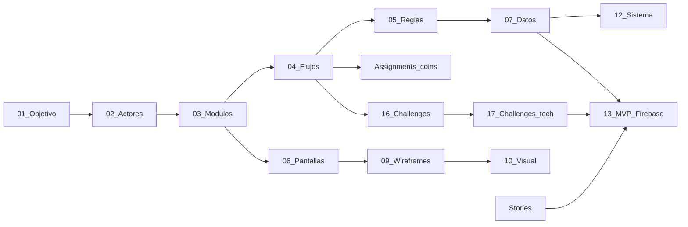

# Documentación de diseño — Índice

Documentation: **Circle** (Evocative World elearning product) with WhatsApp-style UX (list → thread → composer), plus **Flutter + Firebase MVP**.

## Leyenda Visión vs MVP

| Etiqueta | Significado |
|----------|-------------|
| **Visión** | Circles tipados, **block Assignments (system chat)**, **Challenges** (media/quest), stories 24 h, Hoy/Práctica, media, filtros, DM secundario |
| **MVP** | Auth Google, home de Circles, admin/roster, posts tipados, assignment system-chat + rail, FCM/media; Challenges = 16/17 |

Docs **01–12** = visión (+ MVP tags). **13** = contrato MVP Firebase. **15** = plan Flutter. **16–17** = Challenges. **18–19** = Assignments.

## Modelo en una frase

WhatsApp-style shell; social object = **Circle**; members progress via **Assignments** (system-chat blocks) and optional **Challenges**; plus free chat and facilitator sticky/resources.

## Orden de lectura recomendado

1. Funcional: [01](01-objetivo.md) → [02](02-actores.md) → [03](03-modulos.md) → [04](04-flujos-clave.md) → [05](05-reglas-negocio.md) → [06](06-mapa-pantallas.md) → [07](07-modelo-datos.md) → [08](08-criterios-exito-ux.md)
2. UX: [09 Wireframes](09-wireframes.md) → [10 Visual](10-diseno-visual.md)
3. Entrega: [11 User stories](11-user-stories.md)
4. Arquitectura: [12 Sistema](12-diseno-sistema-vision.md) → [13 MVP Firebase](13-diseno-tecnico-mvp-firebase.md)
5. Prototipo UX: [14 Wireframe HTML](14-plan-wireframe-html.md) → [`../wireframe/`](../wireframe/)
6. Implementación app: [15 Plan Flutter MVP](15-plan-flutter-mvp.md) → código [repo root](../)
7. Challenges: [16 Functional](16-challenges-funcional.md) → [17 Technical](17-challenges-tecnico.md)
8. Assignments: [18 Functional](18-assignments-funcional.md) → [19 Technical](19-assignments-tecnico.md)

## Tabla de contenidos

| Doc | Título | Capa |
|-----|--------|------|
| [00](00-indice.md) | Índice | — |
| [01](01-objetivo.md) | Objetivo (aprendizaje + shell chat) | Visión |
| [02](02-actores.md) | Actores (Admin, Participante, Círculo) | Visión / MVP |
| [03](03-modulos.md) | Módulos | Visión / MVP |
| [04](04-flujos-clave.md) | Flujos clave | Visión / MVP |
| [05](05-reglas-negocio.md) | Reglas de negocio | Visión / MVP |
| [06](06-mapa-pantallas.md) | Mapa de pantallas | Visión / MVP |
| [07](07-modelo-datos.md) | Modelo Circle / Membership / Post / Story | Visión |
| [08](08-criterios-exito-ux.md) | Criterios UX | Visión / MVP |
| [09](09-wireframes.md) | Wireframes (composer tipado) | Visión / MVP |
| [10](10-diseno-visual.md) | Diseño visual | Visión / MVP |
| [11](11-user-stories.md) | User stories | Visión / MVP |
| [12](12-diseno-sistema-vision.md) | Diseño de sistema | Visión |
| [13](13-diseno-tecnico-mvp-firebase.md) | MVP Firebase + Flutter | **MVP** |
| [14](14-plan-wireframe-html.md) | Plan: wireframe HTML ampliado (paso 1) | Prototipo UX |
| [15](15-plan-flutter-mvp.md) | Plan: Flutter MVP | **Implementación** |
| [16](16-challenges-funcional.md) | Challenges (functional) | **Challenges** |
| [17](17-challenges-tecnico.md) | Challenges (technical) | **Challenges** |
| [18](18-assignments-funcional.md) | Assignments system chat (functional) | **Assignments** |
| [19](19-assignments-tecnico.md) | Assignments (technical) | **Assignments** |

**Prototipo clicable:** [wireframe/](../wireframe/). **App:** [app /](../).

## Mapa de dependencias

## Nota

La documentación de diseño está en esta carpeta. El **wireframe interactivo** vive en [`../wireframe/`](../wireframe/). La **app Flutter** vive en [repo root](../).
