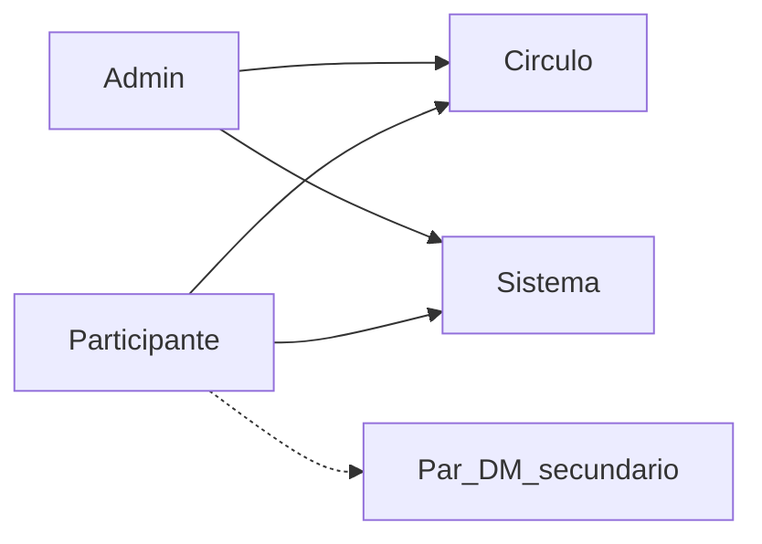

# 02 — Actores

**Propósito:** identificar quién interactúa con el sistema y qué responsabilidad tiene cada uno.

**Alcance:** visión completa (Círculos de aprendizaje).

**Relacionados:** [Índice](00-indice.md) · [Objetivo](01-objetivo.md) · [Módulos](03-modulos.md) · [Reglas de negocio](05-reglas-negocio.md)

---

## Catálogo de actores

### 1. Admin

Facilitador o responsable del espacio de aprendizaje.

**Capacidades:**

- Crear y editar Círculos.
- Añadir / quitar participantes (roster).
- Diseñar el programa de aprendizaje del Círculo:
  - crear **Assignments**,
  - definir **Objectives** (lectura, práctica matutina, audio, etc.),
  - establecer reglas de completitud y cómo se evidencia el progreso.
- Asignar roles por Círculo:
  - **Pointer** (quién guía el foco),
  - **Time keeper** (quién cuida el tiempo).
- Programar la **próxima reunión** (`nextMeetingAt`).
- Publicar contenido de programa:
  - **instrucciones sticky** (solo admin),
  - **recursos** (PDF/video/Google Drive con link).
- Moderar contenido y orientar el ritmo del círculo (visión: vista “Hoy”).

### 2. Participante (member)

Miembro de uno o más Círculos.

**Capacidades:**

- Publicar mensajes libres dentro del Círculo (chat cotidiano).
- Participar en el cumplimiento:
  - abrir una **moneda (coin)** del rail de Assignments,
  - revisar la lista de **Objectives**,
  - marcar evidencia/progreso según las reglas definidas por el admin.
- Ver progreso del círculo:
  - progreso personal,
  - señales agregadas del grupo (cuando aplique).
- Ver roles del círculo (Pointer/Time keeper) e instrucciones sticky.
- Ver próxima reunión.
- Silenciar o fijar Círculos en su lista.
- No crea ni elimina Círculos.

### 3. Círculo (contexto)

Espacio colectivo con membresía, hilo tipado y rail de **coins de Assignments** con objectives y progreso.

Además, concentra instrucciones sticky, recursos y la información de próxima reunión. No es un actor humano, pero define el perímetro de visibilidad y permisos.

### 4. Sistema

Notificaciones, sync, TTL de stories, enforcement de membresía, compresión/cola de media, estados de entrega.

### 5. Par en DM (secundario)

Otro participante en un chat 1:1 opcional para apoyo puntual. No forma parte del núcleo de home.

---

## Matriz de interacción

| Actor | Interactúa con | Ejemplo |
|-------|----------------|---------|
| Admin | Círculo | Crear/gestionar assignments, roster, moderar |
| Participante | Círculo | Ver coin rail, marcar objectives, publicar mensajes |
| Admin / Participante | Sistema | Sync, push, offline |
| Participante | Par DM | Apoyo 1:1 (secundario) |

## Actores en el MVP

| Visión | MVP Firebase |
|--------|----------------|
| Admin | Usuario con `role: admin` en membership (o flag) |
| Participante | Google Auth + membership `member` (y roles Pointer/Time keeper asignables) |
| Círculo | Colección `circles` + `memberships` |
| Sistema E2EE / llamadas | No; sync Firestore |
| DM | Fuera de fase 1 |
