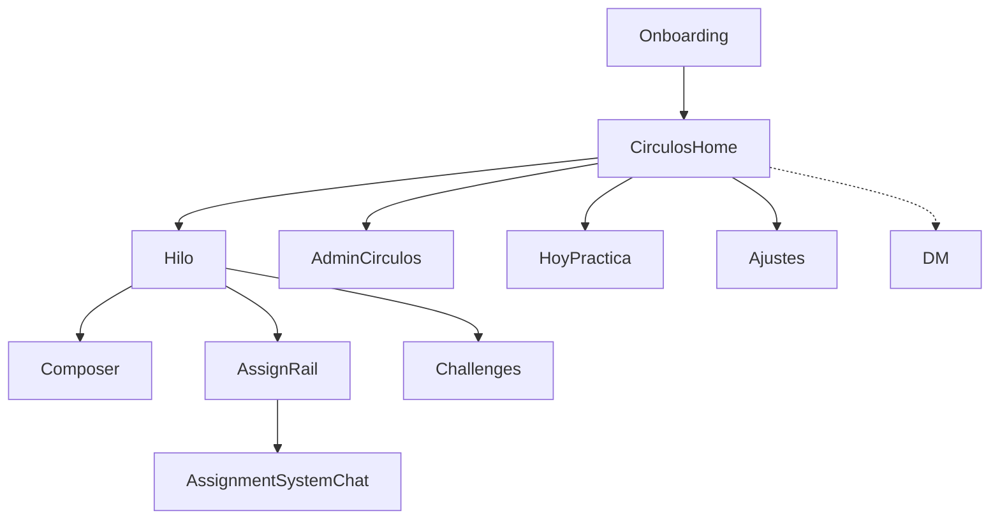

# 03 — Módulos principales

**Propósito:** descomponer el producto en módulos funcionales y dependencias (shell WhatsApp + Círculos).

**Alcance:** visión completa; cobertura MVP al final.

**Relacionados:** [Índice](00-indice.md) · [Flujos clave](04-flujos-clave.md) · [Mapa de pantallas](06-mapa-pantallas.md) · [User stories](11-user-stories.md)

---

## Tabla de módulos

| Módulo | Función principal | Capacidades clave |
|--------|-------------------|-------------------|
| **Onboarding** | Alta y perfil | Auth (visión OTP / MVP Google), nombre, avatar, permisos |
| **Círculos (home)** | Lista tipo WhatsApp | Mis Círculos por actividad, preview del último progreso, badge, pin, mute, búsqueda |
| **Assignment rail** | Gamificación + atajo del día | Chips por assignment (tap → system-chat thread); chip **challenge of the day**. Sin create en el rail—vía AppBar |
| **Assignment system chat** | Cumplimiento por bloques | Composer Content + Needs a response; estudiante responde en el mismo hilo ([doc 18](18-assignments-funcional.md)) |
| **Hilo del Círculo** | Comunidad + mensajes | Feed tipado; se apoya en assignment rail |
| **Composer tipado (admin)** | Distribuir contenido del programa | Publica `instruction` sticky y `resource` + mensajes libres |
| **Admin Círculos (programa)** | Diseñador del aprendizaje | Crea assignments (system chat), roles, nextMeetingAt |
| **Content Library** | Catálogo reutilizable del facilitador | Resources / challenges / assignments; crear en Hoop **refleja** en Library; Publish clona a otros Hoops |
| **Challenges** | Práctica diaria personal | Catálogo por círculo; enroll + hora diaria; sesión `media` o `quest`; create in-Hoop mirrors to Library ([doc 16](16-challenges-funcional.md)) |
| **Hoy / Práctica** | Ritual diario | Atajos y vista del día (visión) |
| **Stories del Círculo** | Efímeros 24 h (visión) | Inspiración corta como “empuje” pedagógico |
| **Ajustes** | Cuenta y preferencias | Perfil, notificaciones, logout; privacidad avanzada en visión |
| **DM** | Apoyo 1:1 | Secundario; no es home |

Llamadas y multi-dispositivo formal **no** son módulos núcleo de aprendizaje (visión diferida).

## Dependencias

| Módulo | Depende de |
|--------|------------|
| Círculos home | Onboarding + memberships |
| Hilo | Círculo abierto |
| Assignment rail | Círculo abierto + membership |
| Assignment system chat | Blocks / answers / submissions |
| Challenges | Círculo abierto + membership; Storage |
| Composer tipado (admin) | Rol admin + hilo del Círculo |
| Admin Círculos (programa) | Rol admin + assignments (+ challenges) |
| Hoy / Práctica | Memberships + posts del día |

## Límites de responsabilidad

- **Home** no renderiza el hilo completo: solo lista y `lastPost` tipado.
- **Composer** define el `type` del Post; el hilo lo presenta con badge/preview.
- **Assignment rail** no sustituye el hilo; resume progreso + challenge-of-day. Create vive en listas AppBar.
- **Assignment blocks** no se escriben en `posts` del Hoop.
- **Challenges** no escriben answers/submissions de assignments ([doc 16](16-challenges-funcional.md)).
- **DM** no aparece como destino por defecto tras login.

## Cobertura MVP

| Módulo | MVP |
|--------|-----|
| Onboarding | Google Auth + perfil mínimo |
| Círculos home | Sí |
| Hilo + composer tipado (texto) | Sí |
| Admin crear círculo + roster | Sí |
| Assignment rail | Sí (submissions / required inputs) |
| Assignment system chat + roster básico | Sí ([doc 18](18-assignments-funcional.md) / [19](19-assignments-tecnico.md)) |
| Challenges | Documentado (16/17); implementación por fases |
| Stories | No (fase posterior) |
| Hoy / Práctica | No (visión) |
| DM | No |
| Media Storage | Fase 2 del MVP |
