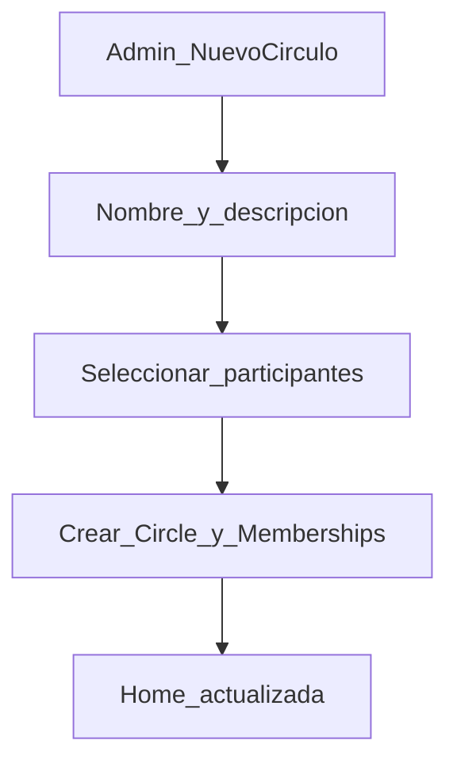
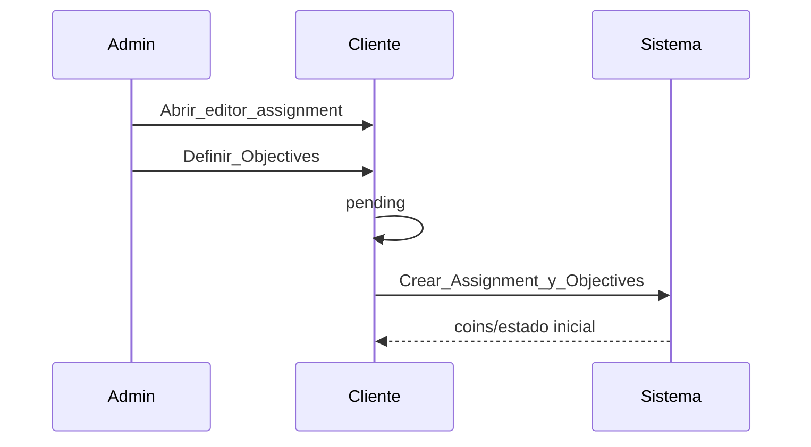
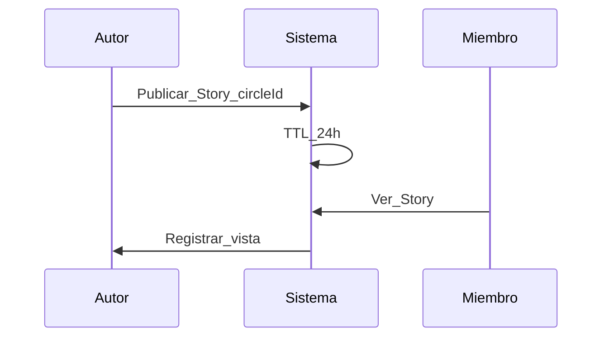

# 04 — Flujos clave

**Propósito:** recorridos críticos del usuario en Círculos de aprendizaje.

**Alcance:** visión completa. MVP implementa flujos 1–3 y mensaje libre (ver [doc 13](13-diseno-tecnico-mvp-firebase.md)).

**Relacionados:** [Índice](00-indice.md) · [Módulos](03-modulos.md) · [Reglas de negocio](05-reglas-negocio.md) · [Wireframes](09-wireframes.md)

---

## 1. Admin crea Círculo y añade participantes

1. Admin abre “Nuevo Círculo”.
2. Define nombre (y opcional descripción / foto).
3. Selecciona participantes → se crean `Membership` con rol `member`; el creador es `admin`.
4. El Círculo aparece en la home de todos los miembros.
5. Cualquier miembro puede abrir el hilo vacío e iniciar el primer post.

---

## 2. Admin crea Assignment y Objectives

1. Admin abre el editor de programa (desde `Info` del Círculo o un sheet admin).
2. Define el **Assignment**:
   - título (ej. “Semana 1: Respiración + lectura”),
   - (visión) ventana/ciclo y próximo hito si aplica.
3. Añade **Objectives**:
   - tipo (leer doc, práctica matutina por minutos, escuchar audio, etc.),
   - regla de completitud y evidencia requerida (check/tiempo mínima/reflexión).
4. (Visión) Define pesos si quieres un progreso compuesto.
5. Publica el Assignment al Círculo.

---

## 3. Miembro completa Objectives en la coin rail

1. Miembro entra al **Hilo del Círculo** y toca la **coin** del Assignment.
2. Ve la lista de **Objectives** con su estado personal (pendiente/completado).
3. Para cada objective:
   - marca evidencia (check/nota/tiempo mínimo según reglas),
   - (visión) añade contexto breve de aprendizaje.
4. El sistema recalcula el progreso y actualiza la coin:
   - progreso personal,
   - señal agregada del grupo (si está configurada).

---

## 4. Discusión de currículo

1. Tipo `curriculum` o mensaje libre citando el módulo.
2. Enviar; el hilo mantiene el contexto del Círculo.
3. Visión: filtro “Currículo” en el hilo.

---

## 5. Morning practice + media inspiracional

1. El miembro completa una objective tipo `morning_practice` (tiempo mínimo o checklist).
2. Opcional: adjunta evidencia con un recurso (audio/video/foto) como referencia.
3. El progreso del Assignment se refleja en la coin (realtime en visión/MVP).

---

## 6. Story del Círculo

1. Desde el carril de stories del Círculo → crear.
2. Publicar contenido efímero; `expiresAt` = +24 h.
3. Miembros ven y registran vista.
4. TTL retira el contenido.

---

## 7. Admin publica instrucciones sticky y recursos

1. Admin crea una **instrucción** `instruction` (sticky) asociada al programa del círculo (y/o al assignment activo).
2. El sticky se fija arriba del hilo y permanece visible mientras el grupo trabaja.
3. Admin crea **recursos** `resource` con `kind` (`pdf` | `video` | `drive`) y un link.
4. Los miembros consultan sticky y recursos desde la cabecera del hilo y/o desde el detalle del assignment.

## 8. Mensaje libre (base WhatsApp)

1. Composer con tipo `free` (default).
2. Enviar texto como en un chat grupal familiar.
3. Reduce fricción cuando no hace falta un tipo ritual.

---

## 9. Facilitator creates a Challenge

1. Open Circle → Challenges → New.
2. Choose kind: **`media`** (upload audio or video; cues baked into file) or **`quest`** (instructions text).
3. Set `durationDays` and optional `preAlarmMinutes`.
4. Publish → members can browse and enroll.

Detail: [doc 16](16-challenges-funcional.md).

## 10. Member enrolls in a Challenge

1. Open challenge detail.
2. Pick start date + daily local time.
3. Confirm → enrollment `active`; sessions scheduled for each day.

## 11. Daily media session

1. Reminder (phase 3: local notification before daily time).
2. Open session → Play audio/video to the end.
3. Session marked `completed` (no separate in-app timer/gong).

## 12. Daily quest session

1. Reminder as above.
2. Read instructions → submit feedback (text and/or image and/or audio).
3. Session marked `completed`.

---

## Flujos en el MVP

| Flujo | MVP |
|-------|-----|
| Crear Círculo + roster | Sí |
| Coin rail (Assignments) + Objectives | Sí (texto/checks en fase 1) |
| Marcar progreso de objectives | Sí (recalcula coin) |
| Sticky instrucciones + recursos (links) | Sí (fase 1: links mock / texto) |
| Currículo / free | Sí (como evidencia y/o mensajes libres) |
| Morning practice texto | Sí (evidencia tipo práctica) |
| Media archivo | Fase 2 |
| Challenges (media / quest) | Documentado 16/17; implementación por fases |
| Story 24 h | No |
