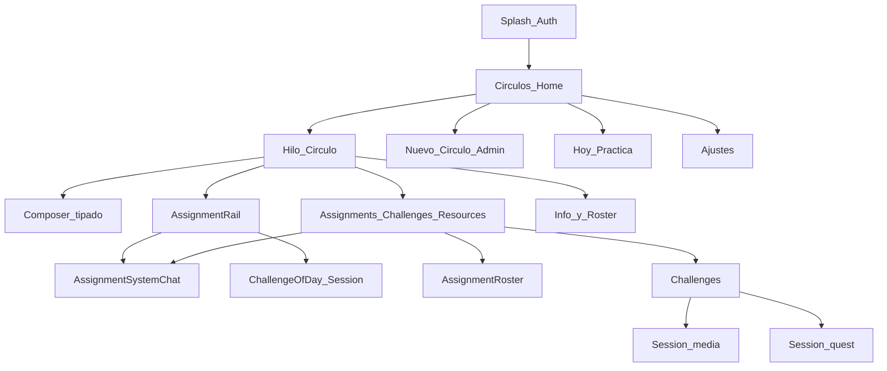

# 06 — Mapa de pantallas

**Propósito:** inventario y navegación funcional (shell WhatsApp + Círculos).

**Alcance:** visión; subset MVP al final.

**Relacionados:** [Índice](00-indice.md) · [Módulos](03-modulos.md) · [Wireframes](09-wireframes.md) · [Flujos](04-flujos-clave.md)

---

## Árbol funcional

```
Splash / Auth
  └─ Círculos (home)
       ├─ Hilo del Círculo
       │    ├─ AppBar icons (condicionales): Challenges / Assignments / Resources → list screens
       │    ├─ Assignment rail (progress chips + challenge-of-the-day; no create)
       │    ├─ Sticky instrucciones + recursos (admin)
       │    ├─ Composer tipado
       │    ├─ Filtros por tipo / estado (visión)
       │    ├─ Info / miembros (admin: roster; pointer/Time keeper; reunión)
       │    ├─ Challenges / Assignments / Resources list screens
       │    └─ Media viewer (visión / fase 2)
       ├─ Nuevo Círculo (solo admin)
       ├─ Assignment system-chat thread / roster
       ├─ Challenge create/edit (facilitator; mirrors to Library)
       ├─ Content Library (catalog; deep-link to linked Hoop items; Publish)
       ├─ Stories del Círculo (visión)
       ├─ Hoy / Práctica (visión)
       ├─ DM (secundario, visión)
       └─ Ajustes
            ├─ Perfil
            ├─ Notificaciones
            └─ Cerrar sesión
```

## Navegación primaria

| Destino | Contenido |
|---------|-----------|
| **Círculos** | Lista home (default post-auth) |
| **Hoy / Práctica** | Atajos del día (visión) |
| **Ajustes** | Perfil y cuenta |

## Navegación secundaria (desde Círculo)

| Destino | Entrada |
|---------|---------|
| Composer tipado | Barra inferior |
| Assignment rail | Chips → system-chat thread; challenge-of-day → today’s session |
| Assignment system chat | Content bubbles + input cards; composer Content / Needs a response |
| Assignments list | AppBar icon; admin create; tap → thread or roster |
| Resources list | AppBar icon; open resource |
| Info / roster | Tap en nombre; admin edita miembros |
| Challenges | AppBar/Info → list; media or quest session |
| Filtros | Chip bar (visión) |

## Diagrama



## Empty / error states

| Pantalla | Estado |
|----------|--------|
| Home | Sin Círculos → copy para esperar invitación o (admin) CTA crear |
| Hilo | Sin posts → hint de primer propósito o mensaje libre |
| Auth | Error de login → reintentar |

## Subset MVP

1. Auth Google  
2. Home Círculos  
3. Hilo del Círculo con assignment rail + system-chat thread / roster ([doc 18](18-assignments-funcional.md))  
4. Composer tipado (texto) y distribución admin-only (sticky instructions + recursos con links mock)  
5. Nuevo Círculo + roster (admin)  
6. Info del Círculo (Pointer/Time keeper + próxima reunión)  
7. Ajustes mínimos (perfil, logout)  

Challenges UI: see [doc 16](16-challenges-funcional.md) (implementation phased).

Fuera de MVP UI: Stories TTL completo, Hoy, filtros avanzados, DM y media viewer avanzado.
