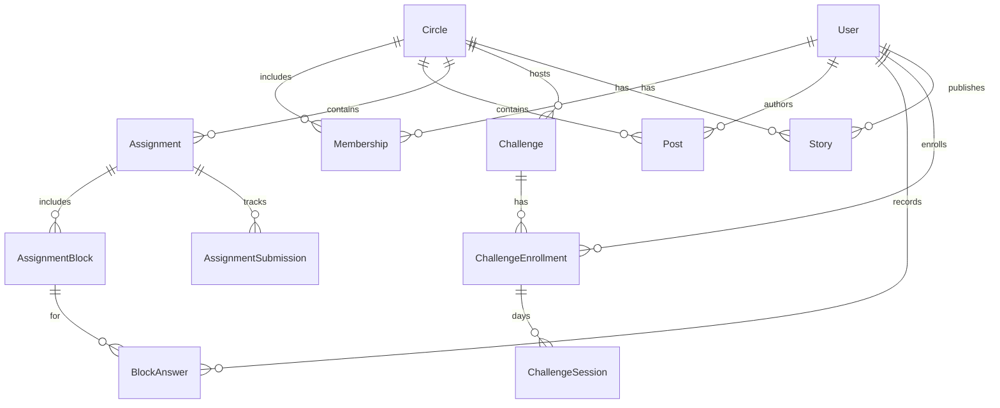
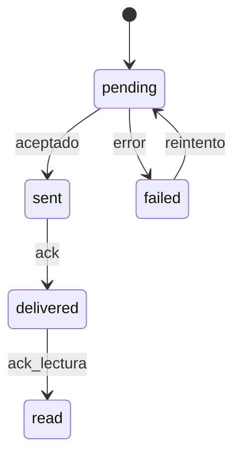

# 07 — Modelo de datos

**Propósito:** modelo conceptual centrado en Círculo / Membership / Post / Story + **Assignment / Block / Answer / Submission** ([doc 18](18-assignments-funcional.md) / [19](19-assignments-tecnico.md)) + **Challenge / Enrollment / Session**. Legacy Objective / ProgressLog: lectura.

**Alcance:** visión conceptual. Mapeo Firestore en [doc 13](13-diseno-tecnico-mvp-firebase.md).

**Relacionados:** [Índice](00-indice.md) · [Reglas](05-reglas-negocio.md) · [Sistema](12-diseno-sistema-vision.md) · [MVP](13-diseno-tecnico-mvp-firebase.md)

---

## Entidades

### User

| Atributo | Notas |
|----------|--------|
| `id` | UID estable |
| `email` / `phone` | MVP: email Google; visión puede añadir phone |
| `name`, `avatar`, `about` | Perfil |
| `createdAt` | Alta |

### Circle

| Atributo | Notas |
|----------|--------|
| `id` | Identificador |
| `name`, `description`, `photo` | Info del espacio |
| `createdBy` | User id (admin inicial) |
| `lastPost` | Preview tipado: type, text, authorId, createdAt |
| `updatedAt` | Orden en home |

### Membership

| Atributo | Notas |
|----------|--------|
| `id` | p. ej. `{circleId}_{userId}` |
| `circleId`, `userId` | FKs |
| `role` | `admin` \| `member` |
| `muted`, `pinned` | Preferencias por usuario (visión) |
| `joinedAt` | Timestamp |

### Post

| Atributo | Notas |
|----------|--------|
| `id` | Identificador |
| `circleId`, `authorId` | FKs |
| `type` | `discussion` \| `free` \| `instruction` \| `resource` \| `system` |
| `body` | Texto |
| `media` | Ref mime/tamaño/thumb (visión / fase 2) |
| `meta` | referencia a evidencia (p. ej. `assignmentId`, `objectiveId`, `kind`, `durationMin`, etc.) |
| `replyTo` | Post id (visión) |
| `status` | `pending` \| `sent` \| `delivered` \| `read` \| `failed` |
| `createdAt` | Timestamp |

### Story

| Atributo | Notas |
|----------|--------|
| `id` | Identificador |
| `circleId`, `authorId` | Anclada al Círculo |
| `body` / `media` | Contenido |
| `expiresAt` | createdAt + 24 h |
| `viewers` | userId + viewedAt |

### Assignment (programa del círculo)

| Atributo | Notas |
|----------|-------|
| `id` | Identificador |
| `circleId` | FK |
| `title` / `description` | |
| `createdBy` | admin |
| `createdAt` | Timestamp |
| `opensAt` / `dueAt` | ventana |
| `allowLate` | bool |
| `publishedAt` | Timestamp? |
| `status` | `draft` \| `published` \| `archived` |

### AssignmentBlock (mensaje del system chat)

| Atributo | Notas |
|----------|-------|
| `id`, `circleId`, `assignmentId`, `order` | |
| `kind` | `content` \| `input` |
| `type` | content: text/media/link; input: question/upload/singleChoice/multipleChoice |
| `required` | bool (input) |
| `payload` | map post-like — [doc 19](19-assignments-tecnico.md) |

### BlockAnswer / AssignmentSubmission

Ver [doc 19](19-assignments-tecnico.md). Rail derivado de submissions (no coin state escrito).

### Legacy: Objective / ProgressLog

Sin nuevos writes desde el builder.

### Challenge (sibling of Assignments)

Template in a Circle. Full fields: [doc 17](17-challenges-tecnico.md). Functional: [doc 16](16-challenges-funcional.md).

| Atributo | Notas |
|----------|-------|
| `id`, `circleId` | Path `circles/{circleId}/challenges/{id}` |
| `kind` | `media` \| `quest` |
| `mediaKind` | `audio` \| `video` when media |
| `storagePath` / `instructions` | Master file **or** quest text |
| `durationDays`, `preAlarmMinutes` | Commitment length + reminder offset |
| `status` | `active` \| `archived` |

### ChallengeEnrollment

| Atributo | Notas |
|----------|-------|
| `challengeId`, `circleId`, `userId` | FKs |
| `startDate`, `dailyTime`, `timezone` | Local schedule |
| `status` | `active` \| `completed` \| `cancelled` |

### ChallengeSession

| Atributo | Notas |
|----------|-------|
| `enrollmentId`, `dayIndex` | One doc per day |
| `scheduledAt`, `state` | `scheduled`…`completed` / `skipped` / `missed` |
| `evidence` | Quest: text and/or image/audio storage paths |
| `playbackEnded` | Media: set when player ends |

### DM (secundario, visión)

Chat 1:1 fuera del núcleo: colección aparte o `Circle` con `kind: dm`. No sustituye home de Círculos.

---

## Relaciones

---

## Estados de Post.status

En MVP basta `pending` (cliente) / `sent` / `failed`.

---

## Consultas conceptuales

| Necesidad | Acceso |
|-----------|--------|
| Home del usuario | Memberships del uid → Circles orderBy updatedAt |
| Hilo | Posts where circleId orderBy createdAt |
| Filtro por tipo | + where type == … |
| Assignment rail | Submissions / blockAnswers por userId + assignmentId (+ circleId en queries) |
| Challenges catalog | `circles/{id}/challenges` where status == active |
| My enrollments | challengeEnrollments where userId + circleId |
| Challenge sessions | challengeSessions where enrollmentId orderBy dayIndex |
| Stories activas | Stories where circleId and expiresAt > now |

## Nota

`Chat` / `Message` del modelo genérico anterior **dejan de ser el centro**. El hilo del Círculo es una secuencia de **Post**.
