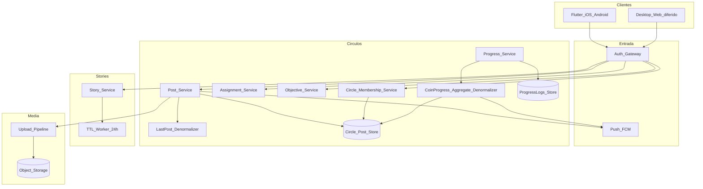

# 12 — Diseño de sistema (visión completa)

**Propósito:** arquitectura alto nivel orientada a Círculos (`circleId`), posts tipados y media — no a DM como núcleo.

**Alcance:** visión. Implementación MVP en [doc 13](13-diseno-tecnico-mvp-firebase.md).

**Relacionados:** [Índice](00-indice.md) · [Modelo de datos](07-modelo-datos.md) · [Reglas](05-reglas-negocio.md)

---

## Objetivos

- Fan-out y authz por membresía de Círculo.
- Baja latencia percibida en posts del hilo.
- Soporte de tipos de contenido y meta de aprendizaje.
- Soporte de **Assignments + Objectives + Progress** y derivación del **coin rail** desde `ProgressLog`.
- Stories con TTL; media comprimida; offline tolerante.
- DM y llamadas solo como satélites (si existen).

---

## Componentes

---

## Flujos de sistema

### Post en Círculo

1. Auth verifica sesión.
2. Membership check (`userId` ∈ círculo).
3. Persistir Post con `type` + body/media/meta.
4. Actualizar `Circle.lastPost` + `updatedAt`.
5. Push a miembros (excepto mute).

### Story

1. Membership check → crear Story con `expiresAt`.
2. Worker TTL oculta/borra.
3. Vistas como subcolección/eventos.

### Assignment / Objectives (admin)

1. Admin crea `Assignment` y sus `Objectives` con reglas de completitud.
2. Se publican en el Círculo; los clientes pueden abrir el assignment sheet.

### Mark progress y actualización de coin rail

1. Miembro completa una objective (según regla).
2. Progress_Service valida evidencia mínima y persiste un `ProgressLog`.
3. CoinProgress_Aggregate_Denormalizer recalcula progreso personal y/o agregado del Círculo.
4. Push/Sync actualiza el coin rail y mantiene consistencia con el hilo.

### Media

1. Cliente comprime → upload → URL en Post `type: media` o adjunto.
2. CDN/object storage; thumbs para lista.

---

## Authz

Toda lectura/escritura de posts, stories, **assignments/objectives** y **progress** exige membership del `circleId`.
Mutaciones de Circle/roster y creación/edición de assignments/objectives exigen `role: admin` del Círculo.
Los miembros solo pueden enviar evidencia/progreso para objectives a las que pertenecen (ProgressLog).

## Observabilidad

- Latencia send→visible p95 por círculo.
- Tasa de posts por tipo (purpose/progress/…).
- Fallos de upload; stories expiradas procesadas.

## Relación con MVP

MVP colapsa Circle/Membership/Post **y** Assignment/Objective/ProgressLog en **Firestore** + **Auth Google** + cliente **Flutter** (iOS/Android). Web/Hosting queda como visión diferida.

El coin rail se apoya en agregación/derivación de progreso (denormalizado o calculado en cliente) para mostrar estados sin lógica pesada. Este documento guía la evolución.
