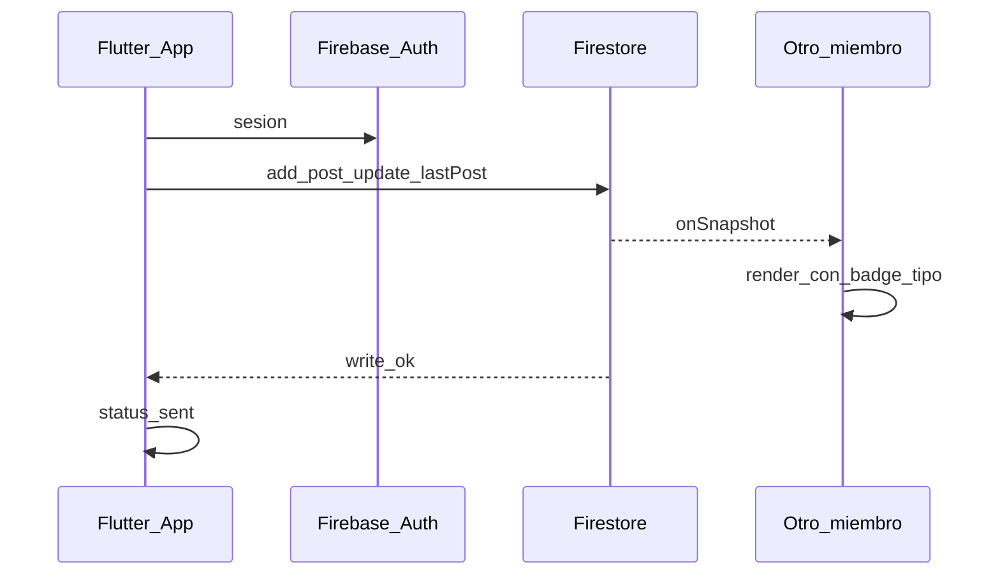

# 13 — Diseño técnico MVP (Firebase + Flutter)

**Propósito:** MVP construible — Círculos de aprendizaje con shell tipo WhatsApp.

**Alcance:** solo MVP. Visión en [doc 12](12-diseno-sistema-vision.md). Plan de implementación: [doc 15](15-plan-flutter-mvp.md).

**Relacionados:** [Índice](00-indice.md) · [Modelo](07-modelo-datos.md) · [Stories](11-user-stories.md) · [Wireframes](09-wireframes.md)

---

## Objetivo MVP

1. Login **Google Auth**
2. Home = **mis Círculos** con preview tipado
3. **Admin** crea Círculo y roster
4. Hilo con **coin rail de Assignments** + **assignment sheet (Objectives)** y marcado de progreso (ProgressLog) en realtime; además mensajes libres (`free`)
5. Uso móvil vía **app Flutter (iOS / Android)** — builds / TestFlight / sideload

## Fuera de alcance MVP

Stories TTL, tab Hoy, DM, llamadas, E2EE, reply/reacciones, filtros de hilo. FCM (fase 2b) **incluido**. Flutter Web / PWA como entrega principal fuera del MVP móvil (Hosting disponible para smoke).

---

## Stack

| Pieza | Tecnología |
|-------|------------|
| Cliente | Flutter (iOS + Android); web para desarrollo |
| Estado / rutas | `flutter_riverpod` + `go_router` |
| Auth | Firebase Auth + Google Sign-In |
| DB | Cloud Firestore |
| Storage | Fase 2a — imágenes + PDF + audio/video en hilo |
| Push | Fase 2b (FCM) — tokens + notifyOnNewPost |

---

## Fase 2a — Media (imágenes + PDF + audio + video)

- `PostType.media` con `meta: { kind, storagePath, downloadUrl, contentType, fileName, … }`
- Path Storage: `circles/{circleId}/uploads/{uid}/{postId}/{fileName}`
- Imágenes: galería o cámara; burbuja con preview vía Storage SDK
- PDF: cualquier miembro (≤20 MB); CF portada página 1
- Audio: nota de voz hold-to-send (≤2 min, ≤5 MB)
- Video: cámara ≤60 s, ≤25 MB; CF primer frame → `cover.jpg`
- Composer estilo WhatsApp: clip (Galería/Cámara/Video/PDF); mic vs enviar
- Rules: `circulo/storage.rules`
- Functions: `circulo/functions/` (Blaze requerido)

---

## Fase 2b — FCM push

- Trigger: `onCreate` en `circles/{circleId}/posts/{postId}` → CF `notifyOnNewPost`
- Destinatarios: miembros del círculo excepto `authorId`
- Payload: título = nombre del círculo; body = preview; data `{ circleId, postId }`
- Tokens: `users/{uid}/fcmTokens/{tokenId}` (`token`, `platform`, `updatedAt`); rules owner-only
- Cliente: `firebase_messaging` + `flutter_local_notifications`; tap → `/circles/{circleId}`
- Web: VAPID (`--dart-define=FCM_VAPID_KEY=…`) + `web/firebase-messaging-sw.js`
- iOS: Push capability / APNs key en Firebase Console; `UIBackgroundModes` → `remote-notification`
- Fuera de v1: mute UI, pushes de objectives, topics a escala

---

## Modelo Firestore

```
users/{uid}
  email, name, photoURL, createdAt
  isPlatformAdmin: boolean   // quien puede crear círculos en MVP cerrado

circles/{circleId}
  name, description, photoURL?
  createdBy: uid
  pointerId: uid?       // (visión) guía del círculo
  timeKeeperId: uid?   // (visión) cuida el ritmo/tiempo
  nextMeetingAt: timestamp?
  lastPost: { type, body, authorId, createdAt, kind? } | null
  updatedAt

memberships/{circleId_uid}
  circleId, userId
  role: "admin" | "member"
  joinedAt

circles/{circleId}/posts/{postId}
  authorId
  type: instruction | resource | discussion | free | system
  body: string
  meta: map   // opcional, puede ir {}
  createdAt
  status: "sent"   // pending solo en cliente

assignments/{assignmentId}
  circleId
  createdBy
  title, description?
  createdAt
  status: "active" | "archived"

objectives/{objectiveId}
  assignmentId
  type: purpose | morning_practice | read_doc | practice_minutes | listen_audio | curriculum
  criteria: map // reglas mínimas (tiempo, check, reflexión, etc.)
  evidenceSpec: map // qué evidencia se guarda en ProgressLog
  order, weight?

progressLogs/{progressLogId}
  circleId (opcional/denormalizado)
  assignmentId
  objectiveId
  userId
  status: "pending" | "completed"
  evidence: map // puede incluir postId/ref a resource + duración/nota
  completedAt?
  updatedAt
```

**Home query:** memberships where userId == uid → fetch circles (o denormalizar `circleIds` en user). Ordenar por `updatedAt`.

**Hilo:** `posts` orderBy `createdAt`.

**Coin rail / assignment sheet:** para un `circleId` se consultan `assignments` + `objectives` y se agregan `progressLogs` del `uid` para derivar el estado de cada coin (pendiente/en progreso/completado). En MVP la agregación puede hacerse en cliente.

Índice: según consultas reales (memberships por userId; posts por circleId+createdAt como subcolección; coin rail requiere indexes/denormalización para `progressLogs` por `userId`+`circleId`/`objectiveId` según el plan).

---

## Flujo de mensaje MVP



---

## Security rules (alto nivel)

- Autenticado para todo.
- `users/{uid}` write solo propio uid.
- `memberships`: read si `userId == auth.uid` o admin del círculo; create/delete de miembros solo admin del círculo (o platform admin al crear).
- `circles`: read si membership; create si `isPlatformAdmin` (o primer admin); update name/description solo admin.
- `posts`: read/create si membership; `authorId == auth.uid` en create; sin delete masivo en fase 1. Si `type` ∈ {`instruction`,`resource`} entonces el creador debe ser `admin` del círculo.
- `assignments` / `objectives`: read si membership; write (create/update) solo `admin` del círculo propietario.
- `progressLogs`: read si membership; write solo para el propio `userId == auth.uid` y solo si la objective pertenece a un Assignment accesible por el `circleId`.

---

## Pantallas MVP

Auth → Home Círculos → Hilo + coin rail → assignment sheet (Objectives) + marcado de progreso → Nuevo Círculo → Ajustes (logout).

Listeners: circles derivados de memberships; posts del círculo abierto.

---

## Distribución

1. Proyecto Firebase: Auth Google + Firestore (sin Hosting como entrega principal).
2. Configurar la app Flutter con FlutterFire (`firebase_options.dart`).
3. Marcar `isPlatformAdmin: true` en el facilitador (`users/{uid}`).
4. Entregar builds: debug local, TestFlight (iOS) y/o APK/sideload (Android).

---

## Criterios técnicos de aceptación

Alineados a stories MVP en [doc 11](11-user-stories.md) y C01–C08 en [doc 08](08-criterios-exito-ux.md):

- Member no crea círculo.  
- Coin rail de Assignments se deriva de objectives + progressLogs.  
- Assignment sheet muestra objectives y evidencia requerida.  
- Marcar objective actualiza progreso y el estado de coins en realtime (o en refresh consistente).  
- Posts de tipo `instruction`/`resource` se ven si es admin del círculo.  
- Realtime entre 2–3 clientes.  
- Rules bloquean lectura sin membership.

---

## Fases siguientes

| Fase | Añadir |
|------|--------|
| 2b | FCM ✅ |
| Challenges | Catalog / enroll / media|quest sessions / local alarms — [doc 16](16-challenges-funcional.md), [doc 17](17-challenges-tecnico.md) |
| 3 | Stories TTL, filtros, mute/pin |
| 4 | Tab Hoy, DMs |
| 5 | Evolución hacia [doc 12](12-diseno-sistema-vision.md) |
