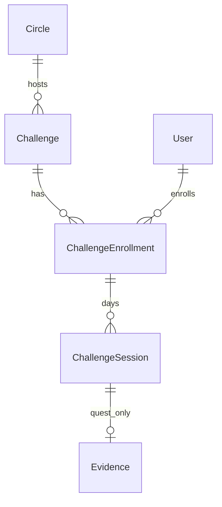

# 17 — Challenges (technical)

**Purpose:** implementation contract for Challenges in Circle (Flutter + Firebase). Functional behavior: [doc 16](16-challenges-funcional.md).

**Related:** [Index](00-indice.md) · [MVP Firebase](13-diseno-tecnico-mvp-firebase.md) · [Flutter plan](15-plan-flutter-mvp.md) · [Data model](07-modelo-datos.md)

---

## 1. Scope and phases

| Phase | Deliverable |
|-------|-------------|
| **1** | Firestore models + rules; Challenges list/detail/enroll/progress UI |
| **2** | Session UI: `media` player (complete on ended) **or** `quest` + evidence upload |
| **3** | Schedule local notifications from enrollment `dailyTime − preAlarmMinutes` (mobile); document web limits |

**Kinds (locked):** `media` | `quest` only. No separate timed/gong engine—cues live inside the media file for `media`.

**Sibling of Assignments:** do not write `progressLogs` / coin state from Challenges.

---

## 2. Firestore

### 2.1 `circles/{circleId}/challenges/{challengeId}`

| Field | Type | Notes |
|-------|------|-------|
| `title` | string | Required |
| `description` | string | Optional |
| `kind` | `'media' \| 'quest'` | Required |
| `mediaKind` | `'audio' \| 'video'` | Required if `kind == media` |
| `storagePath` | string | Master media path if media |
| `contentType` | string | e.g. `audio/mpeg`, `video/mp4` |
| `instructions` | string | Required if `kind == quest` |
| `durationDays` | number | ≥ 1 |
| `preAlarmMinutes` | number | Default `10` |
| `status` | `'active' \| 'archived'` | Default `active` |
| `createdBy` | string | uid |
| `createdAt` | timestamp | |
| `updatedAt` | timestamp | |

### 2.2 `challengeEnrollments/{enrollmentId}`

Suggested id: `{challengeId}_{userId}` (enforces one active doc; archive/re-enroll may use new id + status).

| Field | Type | Notes |
|-------|------|-------|
| `circleId` | string | |
| `challengeId` | string | |
| `userId` | string | |
| `startDate` | string | `YYYY-MM-DD` in user local calendar |
| `dailyTime` | string | `HH:mm` 24h local |
| `timezone` | string | IANA, e.g. `Europe/Madrid` |
| `status` | `'active' \| 'completed' \| 'cancelled'` | |
| `createdAt` | timestamp | |
| `completedAt` | timestamp? | |

### 2.3 `challengeSessions/{sessionId}`

Suggested id: `{enrollmentId}_{dayIndex}` (dayIndex 1…N).

| Field | Type | Notes |
|-------|------|-------|
| `circleId` | string | |
| `challengeId` | string | |
| `enrollmentId` | string | |
| `userId` | string | |
| `dayIndex` | number | 1…durationDays |
| `scheduledAt` | timestamp | Local daily time converted to UTC for that calendar day |
| `state` | `'scheduled' \| 'in_progress' \| 'completed' \| 'skipped' \| 'missed'` | |
| `startedAt` | timestamp? | |
| `completedAt` | timestamp? | |
| `evidence` | map | Quest: `{ text?, imageStoragePath?, audioStoragePath? }` — at least one on complete |
| `playbackEnded` | bool? | Media: set true when player fires ended |

### 2.4 Indexes

| Query | Fields |
|-------|--------|
| Enrollments by user in circle | `userId` ASC, `circleId` ASC, `status` ASC |
| Enrollments by challenge | `challengeId` ASC, `status` ASC |
| Sessions by enrollment | `enrollmentId` ASC, `dayIndex` ASC |
| Today’s sessions for user | `userId` ASC, `scheduledAt` ASC (or query by dayIndex after computing local day) |

Add to [`circulo/firestore.indexes.json`](../firestore.indexes.json) at implementation time.

---

## 3. Storage

| Asset | Path |
|-------|------|
| Challenge master media | `circles/{circleId}/challenges/{challengeId}/master/{fileName}` |
| Quest evidence image | `circles/{circleId}/challenges/{challengeId}/enrollments/{enrollmentId}/sessions/{sessionId}/image/{fileName}` |
| Quest evidence audio | `…/audio/{fileName}` |

Reuse size limits consistent with existing media where practical (e.g. image ≤5 MB, audio ≤5 MB, video for master may allow larger—document at implement, e.g. ≤100 MB for challenge masters).

Update [`circulo/storage.rules`](../storage.rules): members of circle read challenge masters; owner write evidence; facilitator write masters.

---

## 4. Security rules (sketch)

**Challenges subcollection**

- `read`: `isMember(circleId)`
- `create` / `update`: `isCircleAdmin(circleId)` (or platform admin helper if already used for circle create)
- `delete`: false (prefer `status: archived`)

**challengeEnrollments / challengeSessions**

- `read`: signed-in and (`resource.data.userId == uid()` or circle admin)
- `create` / `update`: `request.resource.data.userId == uid()` and `isMember(circleId)`
- Admin may read all enrollments/sessions in their circle for facilitation (optional v1+)

Exact helpers mirror [`circulo/firestore.rules`](../firestore.rules) `isMember` / `isCircleAdmin`.

---

## 5. Client architecture

Under [`circulo/lib/`](../lib/):

```
features/challenges/
  challenges_list_screen.dart
  challenge_detail_enroll_screen.dart
  challenge_edit_screen.dart      # facilitator
  session_media_screen.dart
  session_quest_screen.dart
  enrollment_progress_screen.dart
domain/models/challenge.dart      # Challenge, Enrollment, Session
data/repositories/challenge_repository.dart
```

**Reuse**

- `audioplayers` / `video_player` for `media` (and quest evidence audio playback)
- `image_picker` + `record` for quest evidence
- `firebase_storage` upload helpers from [`media_repository.dart`](../lib/data/repositories/media_repository.dart)
- Phase 3: `flutter_local_notifications` (already in app for FCM foreground)

**Routes (go_router)** — examples:

- `/circles/:circleId/challenges`
- `/circles/:circleId/challenges/new`
- `/circles/:circleId/challenges/:challengeId`
- `/circles/:circleId/challenges/:challengeId/session/:sessionId`

**CoinRail challenge-of-the-day (no schema change)**

- UI: [`features/coins/coin_rail.dart`](../lib/features/coins/coin_rail.dart) — `challengeOfDayProvider` + `_ChallengeDayChip` (not a coin).
- Data: `myCircleEnrollmentsProvider(circleId)` → sort by `createdAt` ASC → for each, `challengeSessionsProvider(enrollmentId)` + `sessionForToday` ([`challenges_providers.dart`](../lib/features/challenges/challenges_providers.dart)); title via `challengeProvider`.
- Tap → `…/challenges/:challengeId/session/:sessionId` for today’s session.
- Rail does **not** create challenges; create remains on Challenges list / AppBar.

---

## 6. Session UI behavior

### Media

1. Load challenge `storagePath` (download URL or SDK getData/stream).
2. Play audio or video.
3. On `onEnded` → set session `state: completed`, `playbackEnded: true`, `completedAt`.
4. No app timer, no second audio track, no bundled gong.

### Quest

1. Show `instructions`.
2. Composer: text field, image attach, voice record (any subset).
3. On submit: upload evidence files → write `evidence` map → `state: completed`.
4. Reject submit if all three channels empty.

---

## 7. Alarms (phase 3) — implemented (mobile)

| Platform | Approach |
|----------|----------|
| **Android / iOS** | Local notification at `scheduledAt − preAlarmMinutes`; **Start practice** action opens session (`?autoplay=1` for media). Reschedule on enroll + app open; cancel on complete/skip/missed |
| **Web** | No reliable ringing alarm (scheduler no-ops) |

Do not depend on FCM for the daily practice alarm (FCM remains for circle posts). Implementation: `circulo/lib/data/repositories/challenge_alarm_scheduler.dart`. Debug-only **TEMP: Test practice alarm** on enrollment progress.

---

## 8. Session generation

**v1 recommendation:** on enroll, create all `challengeSessions` docs for dayIndex `1…durationDays` with `scheduledAt` computed from `startDate`, `dailyTime`, `timezone`. Mark past incomplete days `missed` via client job on app open or a small scheduled Function later (Function optional; not required for phase 1–2).

---

## 9. ER (logical)



---

## 10. Implementation checklist

Phase 1

- [ ] Models + repository + rules + indexes
- [ ] Facilitator create/edit media & quest
- [ ] Member list, detail, enroll, progress

Phase 2

- [ ] Media session player + complete on ended
- [ ] Quest session + evidence upload
- [ ] Skip day

Phase 3

- [x] Local notification scheduling + Start practice action (Android/iOS)
- [x] Cancel on session complete / skip / missed; reschedule on enroll + login
- [x] Web: no-op (documented above)

---

## 11. Out of scope (technical v1)

- App-side multi-track mixer, timer UI, bundled gong assets for challenges
- Cloud Function that “runs” the session
- Writing Assignments / ProgressLog from Challenges
- Challenge completion FCM to the whole circle (optional later)

---

## 12. Doc / code pointers

| Item | Location |
|------|----------|
| Functional | [doc 16](16-challenges-funcional.md) |
| Flutter plan epic | [doc 15](15-plan-flutter-mvp.md) |
| Existing media patterns | `circulo/lib/data/repositories/media_repository.dart` |
| FCM (unrelated daily alarm) | `circulo/lib/data/repositories/messaging_repository.dart` |
